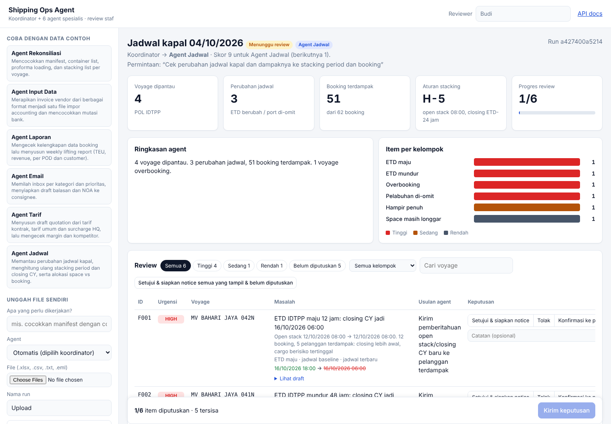
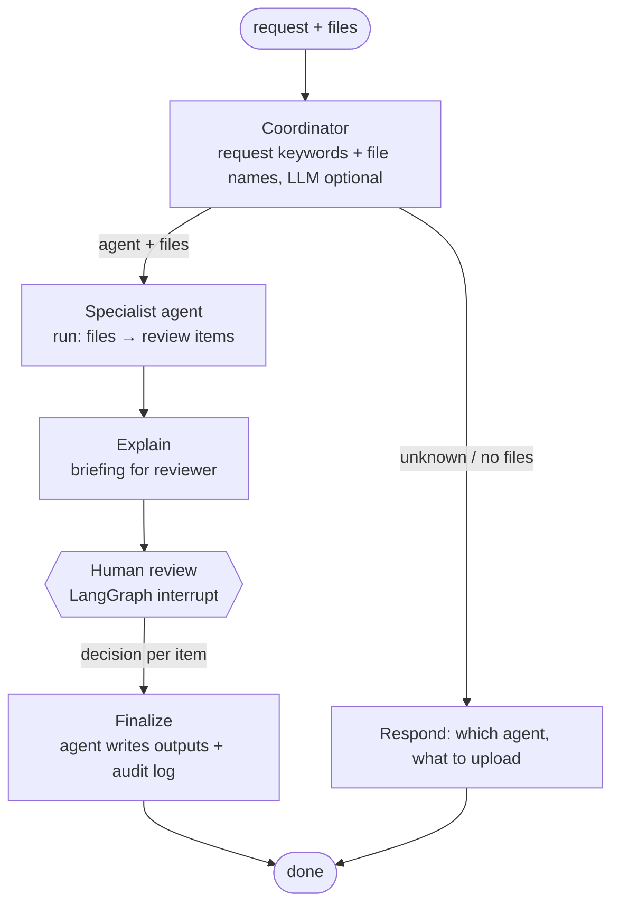
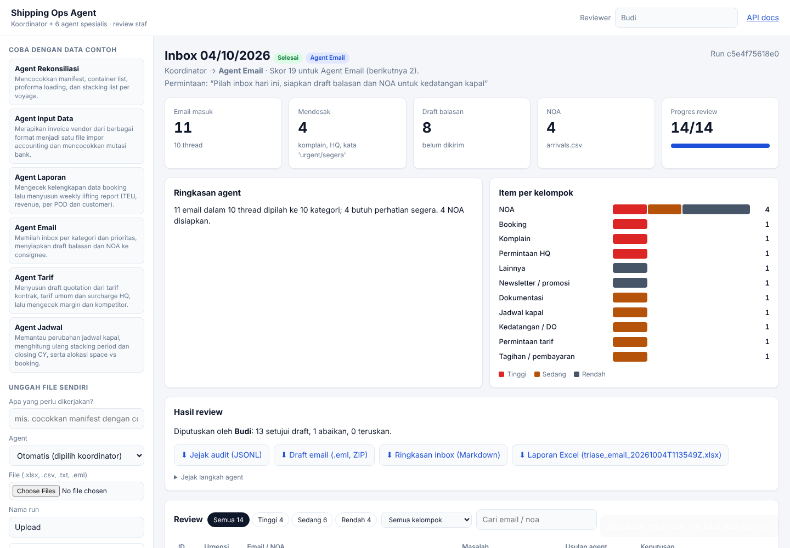

# Shipping Ops Agent

A LangGraph multi-agent system for shipping operations: **one coordinator and six specialist agents**. Each one turns the files staff already handle (Excel exports, invoices, `.eml` inbox exports, schedules) into review items. **Nothing is written, imported or sent until a person decides on every item.**

Built from a survey of shipping operations staff (91 reported pain points). Each agent maps to one category of that survey.

Two front ends share one FastAPI backend: a **Next.js + TypeScript** dashboard (`frontend/`) with types generated from the API schema, and a zero-build HTML page served by FastAPI itself for quick demos.



| Agent | Survey pain point (count) | What it does | Output after review |
| --- | --- | --- | --- |
| **Koordinator** | – | Routes a request to the right agent from the request text and the uploaded file names (LLM optional) | – |
| **Rekonsiliasi** | Checking & matching data across sources (37) | Manifest vs container list vs proforma loading vs stacking list: missing/duplicate containers, ISO 6346 check digit, look-alike IDs, weight/POD/seal mismatches, NPWP | Excel report, POL email draft |
| **Input Data** | Manual input & copying (16) | Vendor invoices from `.xlsx`/`.csv`/`.txt` with different layouts → one schema; vendor master (fuzzy), duplicate and swapped invoice numbers, bank statement matching | Accounting import CSV (approved rows only), vendor email draft |
| **Laporan** | Recurring reports (13) | Data checks first (missing CBF from CS, swapped columns, duplicates, revenue outliers), then weekly lifting report: TEU, revenue, week-over-week, per POD/customer | Markdown + Excel report, CS email draft |
| **Email** | High-volume correspondence (10) | Inbox triage by category and urgency, entity extraction (booking, container, B/L, voyage), reply drafts, Notice of Arrival per consignee with the latest address | Inbox digest, `.eml` drafts (ZIP) |
| **Tarif** | Rates, quotations & prices (9) | Quotation from contract rate → public tariff, plus surcharges valid on the shipment date (HQ updates), margin floor and competitor check | Quotation drafts, HQ email draft |
| **Jadwal** | Schedules & changes (6) | Baseline vs latest schedule: ETD shifts, recomputed open stack / CY closing, omitted ports, affected bookings, space allocation vs booked TEU (roll proposal) | Customer notices, liner email draft |

Stowage and bay plans are deliberately left to the planner.

## Architecture



Every agent implements the same contract (`agents/base.py`):

```python
class Agent(ABC):
    decision_options: list[DecisionOption]          # e.g. Setujui / Tolak / Tanya POL
    def run(self, folder) -> AgentResult: ...       # KPIs + ReviewItems (+ optional drafts)
    def finalize(self, result, decisions, out_dir): ...  # writes outputs from decisions only
    def demo(self, base) -> Path: ...               # fictional data with known issues
```

So the graph, API, dashboard and CLI have no agent-specific code. Adding an agent means one class plus one line in `agents/registry.py`.

### Frontend (Next.js 16 + TypeScript)

```
frontend/src/
  app/layout.tsx              shell: top bar, sidebar, toast
  app/page.tsx                start screen
  app/runs/[id]/page.tsx      one run per URL (shareable, survives reload)
  components/sidebar.tsx      demo per agent, upload (auto-routing or pick an agent), ask, history
  components/run-screen.tsx   KPIs, chart, review table, submit
  components/review-table.tsx decision buttons come from the agent's options
  lib/api-types.ts            GENERATED from FastAPI /openapi.json (openapi-typescript)
  lib/api.ts                  typed client
  lib/review.ts (+ .test.ts)  pure review logic: filters, bulk decide, payload guard (Vitest)
```

- **One contract.** FastAPI response models (`RunView`, `AgentInfo`, `ReviewItem`...) → `shipping-agent openapi` → `npm run gen:api` → TS types. CI regenerates both and fails on any diff, so the backend cannot change a field without the frontend noticing at compile time.
- **Same origin.** `next.config.ts` proxies `/api/*` (and `/api-docs`) to FastAPI: no CORS in the browser, file downloads just work. Set `API_URL` at build time for another backend address.
- **Review drafts survive a reload** (localStorage per run), and the client refuses to send a partial review before the API would.



## Design decisions

- **Code compares, the LLM talks.** Matching IDs, amounts, dates, rates and schedules is deterministic Python with tests. The LLM (optional) only routes requests, classifies emails that keywords miss, extracts fields from unreadable text invoices, and rewords the briefing.
- **Human-in-the-loop is enforced by the graph.** `human_review` calls `interrupt()`; `finalize` is the only node that writes files. Tests assert no output exists before review, and the API rejects partial, duplicate, unknown or other-agent decisions.
- **Approve means "follow the agent's suggestion", per item.** The suggestion says exactly what will happen (drop a duplicate row, use the master vendor name, hold a booking from the report, roll the latest bookings).
- **Drafts are never sent.** Emails are `.eml` or text drafts for staff to open and send.
- **Real-world input.** Header aliases (`CNTR NO`, `No. Tagihan`, `Pelabuhan Tujuan`), Indonesian number and date formats (`Rp 12.500.000,00`, `5-Okt-2026`), and sequential vs swapped numbers (`0118/0119` is normal, `0118/0181` is flagged).
- **Runs offline.** No API key needed for the demo, tests or CI.
- **Audit trail.** Each decision is appended to `audit_log.jsonl` with agent, reviewer, timestamp and note.

## Quick start

```bash
cd backend
python -m venv .venv && source .venv/bin/activate
pip install -e ".[dev]"
shipping-agent serve                               # API + simple dashboard on http://127.0.0.1:8000
```

Next.js dashboard, in a second terminal:

```bash
cd frontend
npm install
npm run dev                                        # http://localhost:3000 (proxies /api to :8000)
```

Terminal only, and tests:

```bash
cd backend
shipping-agent demo --agent all --auto-approve     # all six agents
shipping-agent demo --agent pricing                # one agent, interactive review
pytest -q                                          # 94 backend tests
cd ../frontend && npm run typecheck && npm test && npm run build
```

After changing an API response model, from `backend/`: `shipping-agent openapi && cd ../frontend && npm run gen:api`.

Your own files:

```bash
shipping-agent run --folder path/to/files --request "cocokkan manifest dengan container list"
shipping-agent run --folder path/to/files --agent data_entry      # skip the coordinator
shipping-agent ask "kapal delay, closing CY berubah"              # routing only
shipping-agent agents                                             # list agents
shipping-agent graph                                              # workflow as Mermaid
```

### Expected files per agent

File names matter: the coordinator and the agents use them as hints.

| Agent | Files (`.xlsx`, `.xls`, `.csv` unless noted) |
| --- | --- |
| Rekonsiliasi | `*manifest*` (required), `*container_list*`, `*proforma*`, `*stacking*`, optional `*master*`/`*customer*` with NPWP |
| Input Data | `*invoice*`/`*tagihan*` tables or `.txt`, optional `*vendor*` master, `*mutasi*`/`*bank*` statement |
| Laporan | `*lifting*`/`*booking*`/`*shipment*` with booking no, ETD, customer, POD, type, qty, revenue, CBF |
| Email | `.eml` files, optional `*arrival*` + `*consignee*` master for NOA |
| Tarif | `*request*` (required), `*contract*`, `*tariff*`, `*surcharge*`, `*cost*`, `*competitor*` |
| Jadwal | `*latest*` schedule (required), `*baseline*`, `*booking*`, `*allocation*` |

Run `shipping-agent demo --agent <name>` and look in `data/sample/<name>/` for a complete example of each.

### API

| Method | Path | Purpose |
| --- | --- | --- |
| `GET` | `/api/agents` | Agents, descriptions and decision options |
| `POST` | `/api/runs/demo` | `{"agent": "<name>"}`: sample data + start a run |
| `POST` | `/api/runs` | Multipart upload: `files[]`, `request`, optional `agent` to skip the coordinator |
| `POST` | `/api/ask` | Coordinator only |
| `GET` | `/api/runs`, `/api/runs/{id}` | History; status, KPIs, items, decisions, files |
| `POST` | `/api/runs/{id}/decisions` | Resume the paused graph (422 for partial/duplicate/invalid, 409 when already reviewed) |
| `GET` | `/api/runs/{id}/files/{name}` | Download an output of that run only |

Interactive docs at `/docs`. Uploads: `.xlsx .xls .csv .txt .eml`, 10 MB each, file names sanitised.

### Optional LLM

```bash
pip install -e ".[llm]"
export ANTHROPIC_API_KEY=... LLM_MODEL=<an Anthropic model id>
```

Any LLM failure falls back to the rule-based path.

## Project layout

```
backend/
  pyproject.toml
  src/shipping_agent/
    agents/base.py            Agent contract, ReviewItem, Excel/audit helpers
    agents/registry.py        the six specialists
    agents/coordinator.py     routing
    agents/reconciliation.py  + rules.py, loader.py, sample_data.py
    agents/data_entry.py
    agents/reporting.py
    agents/email_agent.py
    agents/pricing.py
    agents/schedule.py
    parsing.py                amounts, dates, company names, look-alike IDs
    graph.py                  LangGraph workflow
    api.py                    FastAPI
    web/index.html            simple dashboard (vanilla JS, no build step)
    cli.py
  tests/                     agents, rules, routing, interrupt/resume, API
  examples/                  sample decisions payload
frontend/                   Next.js + TypeScript dashboard (see above)
```

## Roadmap

- Postgres checkpointer so runs survive a restart and another staff member can continue a review
- Login, so the reviewer name comes from the account
- PDF B/L and invoice extraction (Input Data agent)
- Connectors: mailbox (IMAP/Graph) for the Email agent, liner schedule feeds for the Jadwal agent
- Agent-to-agent hand-off (e.g. a rate email from the Email agent opens a Tarif run)

All sample data is fictional.
